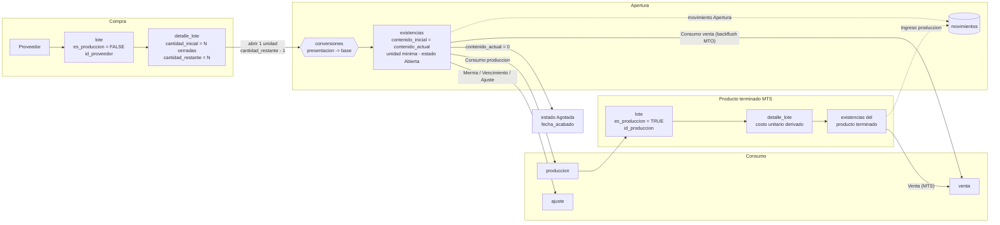
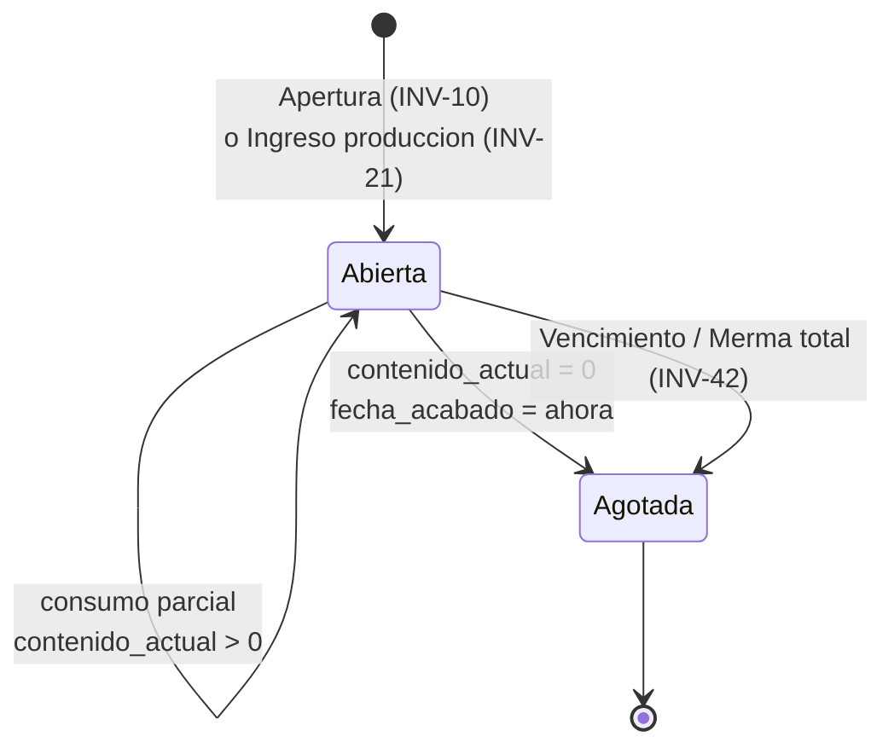
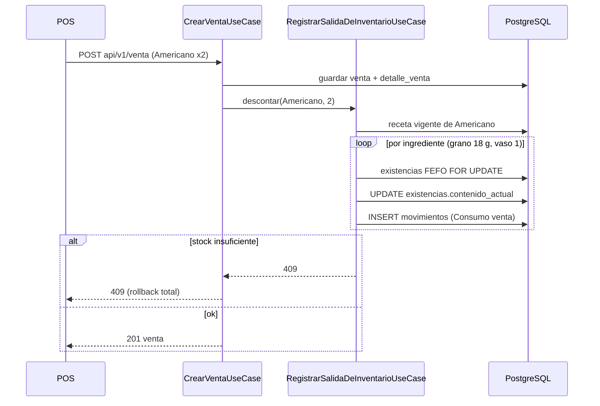

# Especificación del Módulo de Inventarios y Producción

> Documento normativo de **dominio**. Fija las reglas de negocio del inventario: compras,
> apertura de empaques, conversión de unidades, producción (MTS), venta bajo receta (MTO) y
> trazabilidad. `arquitectura.md` sigue mandando sobre **cómo** se escribe el código (capas,
> puertos, nombres, prohibiciones); este documento manda sobre **qué** debe hacer.
>
> Si una regla de aquí obliga a romper una de `arquitectura.md` (por ejemplo, un bloqueo
> pesimista en un `JpaRepository`), se actualiza primero `arquitectura.md` y después el código.
>
> Cada regla lleva un identificador (`INV-xx`) para citarla en código, tests y revisiones. La
> sección 6 indica qué reglas ya están implementadas y cuáles están pendientes.
>
> Cómo usa la venta estas reglas (precio, descuentos, anulación, reintegro, pedidos) está en
> `ventas.md`, que cita las `INV-xx` por su identificador.

---

## Glosario

| Término | Significado |
|---|---|
| **Presentación** | Producto tal como se compra: *Bolsa de café 5 kg*, *Caja de 24 aguas*. Tiene `id_producto_padre`. |
| **Producto base** | Producto tal como se consume: *Café en grano* (g), *Agua 500 ml* (unidad). Es el `id_producto_padre` de sus presentaciones. Las recetas referencian siempre productos base. |
| **Presentación candidata** | Presentación de un producto base con al menos una unidad cerrada no vencida (INV-13). |
| **Unidad cerrada** | Empaque sin abrir que cuelga de un `detalle_lote`. Se cuenta en `detalle_lote.cantidad_restante`. |
| **Existencia** | Empaque abierto y en uso. Su contenido se expresa en la **unidad mínima utilizable** del producto base (`existencias.contenido_actual`). |
| **Saldo utilizable** | Contenido abierto disponible más el contenido de las unidades cerradas que se pueden abrir (INV-31). |
| **MTS** | *Make-to-Stock*: `producto.es_stock_directo = TRUE`. Tiene stock físico propio. |
| **MTO** | *Make-to-Order*: `producto.es_stock_directo = FALSE`. Se prepara al pedirlo y no tiene stock propio. |
| **Backflush** | Descuento automático de los insumos de una receta en el momento de la venta. |
| **FEFO** | *First Expired, First Out*: se consume primero lo que vence antes. |

---

## 1. Ciclo de Vida del Stock y los Insumos



### 1.1 Adquisición e ingreso (compras)

- **INV-01.** Una compra se registra como un `lote` con `es_produccion = FALSE`,
  `id_proveedor` obligatorio e `id_produccion` nulo (`chk_lote_origen`). Se crea solo por
  `POST api/v1/lote`.
- **INV-02.** Cada renglón es un `detalle_lote` de una **presentación** (o de un producto base,
  si se compra suelto) con:
  - `cantidad_inicial`: unidades cerradas compradas (10 bolsas).
  - `cantidad_restante`: unidades **aún cerradas**. Nace igual a `cantidad_inicial` y solo baja
    con una apertura (INV-10) o un ajuste explícito.
  - `precio_unitario`: precio de **una unidad cerrada** (una bolsa).
  - `fecha_vencimiento`: caducidad del empaque cerrado.
  - `fraccionable`: `TRUE` si el empaque se consume por partes (bolsa de café) y `FALSE` si se
    usa entero (una botella de agua, que se vende tal cual).
- **INV-03.** `lote.total` es derivado: Σ `cantidad_inicial × precio_unitario` de las líneas
  vivas. Nunca se acepta del cliente.
- **INV-04.** Una compra **no crea existencias**. El stock comprado queda como unidades cerradas
  hasta que se abre.

### 1.2 Estados de una existencia



- **INV-05.** Una existencia `Agotada` es terminal: no vuelve a `Abierta`. Un ajuste positivo
  sobre stock ya agotado se registra contra una existencia nueva o abierta, nunca reviviendo
  la agotada.

---

## 2. Mecanismo de Desempaque y Conversión de Unidades

### 2.1 Jerarquía presentación → producto base

- **INV-06.** El producto de un `detalle_lote` puede ser:
  - una **presentación** (`id_producto_padre` no nulo): la existencia que se abra contiene al
    **producto base** (el padre), en la `unidad_actual` del padre;
  - un **producto base** (`id_producto_padre` nulo): la existencia contiene al mismo producto,
    en su propia `unidad_actual`.
- **INV-07.** La jerarquía tiene **un solo nivel**: una presentación no puede tener a otra
  presentación por padre. Si el padre de A tiene a su vez un padre, la operación se rechaza
  con 409.
- **INV-08.** Las recetas (`ingredientes_receta.id_producto`) y las existencias se expresan
  siempre en términos del **producto base**. Consumir *Café en grano* consume de las
  existencias abiertas desde cualquiera de sus presentaciones.

### 2.2 Cálculo del contenido de una apertura

La unidad de origen es la `unidad_actual` de la presentación (p. ej. *Bolsa 5 kg*), y la de
destino, la `unidad_actual` del producto base (p. ej. *g*). El contenido de **una** unidad
cerrada es:

```
contenido_inicial = 1 × factor(unidad_presentacion → unidad_base)
```

- **INV-09 — Resolución del factor.**
  1. Si ambas unidades son la misma, el factor es 1.
  2. Si existe una fila viva `conversiones(origen, destino)`, el factor es `factor_conversion`.
  3. Si existe la fila inversa `conversiones(destino, origen)`, el factor es
     `1 / factor_conversion`, calculado con `BigDecimal` a escala 10 y `HALF_UP`, y redondeado
     a la escala de `existencias` (4) solo al final.
  4. Si no hay fila directa, se busca un **camino** entre las dos unidades (búsqueda en
     anchura sobre el grafo de conversiones vivas, en ambos sentidos, máximo 4 saltos). El
     factor es el producto de los factores del camino. Si hay varios caminos, gana el más
     corto.
  5. Si no hay camino, la apertura se rechaza con 409:
     `"No existe conversion de '<unidad origen>' a '<unidad destino>'"`.
- **Recomendación de datos.** Registrar las conversiones de la unidad mayor a la menor
  (factor ≥ 1): `factor_conversion` es `NUMERIC(12,4)` y un factor como 1/3785 pierde precisión.

Ejemplo:

| Presentación | Unidad presentación | Base | Unidad base | Conversiones | contenido_inicial |
|---|---|---|---|---|---|
| Bolsa café 5 kg | bolsa-5kg | Café en grano | g | bolsa-5kg→kg = 5; kg→g = 1000 | 5 × 1000 = **5000 g** |
| Leche 1 L | L | Leche | ml | L→ml = 1000 | **1000 ml** |
| Agua 500 ml | unidad | Agua 500 ml | unidad | (misma unidad) | **1** |

### 2.3 Operación de apertura

- **INV-10 — Abrir una unidad cerrada**, en una sola transacción:
  1. Bloquear el `detalle_lote` (INV-52) y exigir `cantidad_restante ≥ 1` (409 si no).
     Exigir que sea el detalle que corresponde abrir de su presentación (INV-14).
  2. Resolver producto base y factor (INV-06, INV-09).
  3. `detalle_lote.cantidad_restante -= 1` (a través de la raíz `Lote`).
  4. Crear la existencia:
     - `id_detalle_lote` = la línea abierta;
     - `contenido_inicial = contenido_actual = factor`;
     - `unidad` = `unidad_actual` del producto base;
     - `fecha_apertura` = ahora;
     - `fecha_vencimiento` = la del `detalle_lote`;
     - `id_estado_existencia` = `Abierta`;
     - `id_usuario` = quien abre.
  5. Registrar un movimiento `Apertura`, con `cantidad = contenido_inicial`, sobre la nueva
     existencia.
- **INV-11.** No se abre una unidad de un detalle vencido (`fecha_vencimiento < hoy`): 409.
  Lo vencido se da de baja con INV-42.
- **INV-12.** `POST api/v1/existencia` no es una vía de ingreso de stock. Crear existencias a
  mano sin apertura rompe la traza (no hay movimiento que las explique). Las existencias nacen
  solo por Apertura (INV-10), por Ingreso de producción (INV-21) o por el reintegro de una
  venta anulada cuya existencia ya estaba agotada (`ventas.md` VEN-42), cada una con el
  movimiento de entrada que la explica.

### 2.4 Elección de la presentación a abrir

Un mismo producto base puede llegar en varias presentaciones: *Harina* en bolsa de 5 kg y
en bolsa de 2 kg, las dos con `id_producto_padre = Harina`. Qué empaque se abre es una
decisión operativa (se abre la bolsa chica para no dejar la grande a medias, o al revés),
así que **la decide siempre el usuario, nunca el sistema**, aunque haya una sola
presentación posible. Así quien produce o vende ve en pantalla qué empaque se abrió antes de
seguir. El sistema sí fija qué unidad concreta de esa presentación se abre: la que vence
antes.

- **INV-13 — Consulta de detalles aperturables.** Dado el id de un producto base, el sistema
  devuelve los `detalle_lote` que pueden convertirse en existencias de ese insumo:

  ```
  GET api/v1/lote/detalles-aperturables?idProducto=<id del producto base>
  ```

  - **Candidatos:** líneas vivas de lotes vivos cuyo producto es el producto base mismo
    (comprado suelto) o una de sus presentaciones (`id_producto_padre = idProducto`), con
    `cantidad_restante ≥ 1` y no vencidas (`fecha_vencimiento` nula o `≥ hoy`).
  - **Una fila por presentación:** de cada producto candidato se devuelve **solo** el
    `detalle_lote` más próximo a vencer (`fecha_vencimiento ASC`, NULL al final; a igual
    fecha, el de lote más antiguo por `fecha_compra` y, como desempate estable, el de menor
    `id`). Mostrar otro
    detalle de la misma presentación invitaría a romper INV-14.
  - **Orden de la lista:** por esa misma fecha de vencimiento, de modo que la primera fila es
    lo que conviene abrir según FEFO; el usuario puede elegir cualquier fila.
  - **Campos de cada fila:** `idLote`, `idDetalleLote`, `idProducto` y `nombre` de la
    presentación, `cantidadRestante` (unidades cerradas de ese detalle),
    `unidadesCerradasTotales` (de esa presentación sumando todos sus detalles),
    `fechaVencimiento`, `contenidoPorUnidad` y `unidadBase` (el resultado de INV-09, p. ej.
    5000 g), y `costoPorUnidadDeContenido` (INV-35).
  - Si el producto no existe responde 404. Si no hay candidatos devuelve lista vacía (200),
    no un error. Si la conversión de alguna presentación no se puede resolver, esa fila sale
    con `contenidoPorUnidad` nulo y la apertura de esa fila fallará con 409 (INV-09).
  - Es una lectura (`@Transactional(readOnly = true)`) y no bloquea filas.

- **INV-14 — Se abre siempre el detalle más próximo a vencer de la presentación elegida.**
  El usuario elige la presentación enviando el `idDetalleLote` que recibió de INV-13:

  ```
  POST api/v1/lote/detalles/{idDetalleLote}/apertura     { "idUsuario": "..." }
  ```

  Dentro de la transacción, ya con el bloqueo tomado (INV-52), se recalcula cuál es el
  detalle más próximo a vencer de **esa misma presentación** con el criterio de INV-13. Si el
  enviado no lo es (otro usuario abrió o se consumió el que tocaba, o el cliente manda un
  detalle arbitrario), la apertura se rechaza con 409:
  `"Debe abrirse primero el detalle '<id>' que vence el <fecha>"`, y el mensaje nombra el que
  corresponde. El cliente vuelve a consultar INV-13. No se abre en silencio otro detalle
  distinto del pedido.

- **Ubicación en la arquitectura.** Ambos endpoints viven bajo `api/v1/lote` y no en un
  `api/v1/detalle-lote`, porque `detalle_lote` es entidad hija sin endpoints propios
  (`arquitectura.md` 5.13 y reglas 27 y 31). Son rutas fuera de los cinco verbos estándar, así
  que antes de implementarlas hay que documentarlas en `arquitectura.md` 4.7 (regla 25). La
  consulta se declara en el puerto de la raíz (`ILoteRepository`), igual que
  `obtenerPorDetalleId`.

---

## 3. Estrategia de Fabricación y Despacho (MTS vs. MTO)

La naturaleza del producto la decide exclusivamente `producto.es_stock_directo`.

| | MTS (`es_stock_directo = TRUE`) | MTO (`es_stock_directo = FALSE`) |
|---|---|---|
| Ejemplo | Sándwich de mortadela, agua embotellada, café en grano | Café americano, latte |
| Stock propio | Sí: existencias propias y `producto.stock` como proyección | No. `producto.stock` no se usa |
| Cómo se repone | Compra + apertura, o producción | No se repone |
| Disponibilidad para el POS | `producto.stock` (INV-30) | Calculada desde la receta (INV-31) |
| Qué descuenta al venderse | Su propio stock (movimiento `Venta`) | Los insumos de su receta (movimiento `Consumo venta`) |
| ¿Se puede producir por lotes? | Sí, si tiene receta | No (409) |

### 3.1 Proyección `producto.stock`

- **INV-20.** Para un producto MTS, `producto.stock` es una **proyección** del saldo abierto:

  ```
  producto.stock = Σ contenido_actual de sus existencias vivas no agotadas
                   (propias y de sus presentaciones, INV-08), en su unidad_actual
  ```

  Toda operación que cambia `contenido_actual` (apertura, consumo, ingreso, ajuste) actualiza
  `producto.stock` **en la misma transacción**, recalculándolo como esa suma (INV-53). El campo
  no se edita a mano: el alta de producto no lo recibe (nace en 0) y el `PUT
  api/v1/producto` lo rechaza con 400. Las existencias y los
  movimientos siguen siendo la fuente de verdad; la proyección existe para validar y mostrar
  rápido. Si difieren, manda Σ `contenido_actual`, y la diferencia es un defecto.

### 3.2 Producción (MTS)

- **INV-21 — Registrar una producción**, en una sola transacción:
  1. La receta debe estar viva y su producto obtenido debe ser MTS (409 si es MTO).
  2. `factor = cantidad_esperada / receta.cantidad`.
  3. Por cada ingrediente vivo se descuenta `ingrediente.cantidad × factor` del producto base
     con el algoritmo de consumo (INV-32). Cada existencia tocada deja un movimiento
     `Consumo produccion` con `id_produccion`.
  4. `diferencia = cantidad_real − cantidad_esperada` es derivada.
  5. Si `cantidad_real > 0`:
     - Se crea un `lote` con `es_produccion = TRUE`, `id_produccion` e `id_proveedor` nulo.
     - Se crea un `detalle_lote` del producto terminado con
       `cantidad_inicial = cantidad_real`, `cantidad_restante = 0` (se abre entero en el acto)
       y `precio_unitario = Σ costo de lo consumido / cantidad_real`. La `fecha_vencimiento`
       (caducidad corta) es obligatoria.
     - Se crea una existencia `Abierta` con `contenido_inicial = contenido_actual = cantidad_real`
       en la `unidad_actual` del producto terminado.
     - Se registra un movimiento `Ingreso produccion` con `id_produccion`.
     - `producto.stock` se recalcula desde sus existencias (INV-20).
  6. Si falta cualquier insumo: 409 y rollback total (no queda producción, consumo ni lote).
- **INV-22.** Una producción registrada es inmutable en cantidades y receta. Solo se corrigen
  `motivo_diferencia` y `fecha_produccion`. Revertirla sería una *anulación* con movimientos
  compensatorios (pendiente, sección 6).
- **INV-23.** El producto terminado se comporta desde ese momento como cualquier MTS: se vende
  (INV-33) o se consume como insumo de otra receta (INV-32).

### 3.3 Disponibilidad de un producto MTO

- **INV-30.** La disponibilidad de un MTS es `producto.stock`: solo el contenido **abierto**,
  porque nada se abre sin que el usuario lo elija (INV-34). Aparte, y solo como dato
  informativo, se puede mostrar el *disponible tras abrir*: el contenido convertible de sus
  unidades cerradas no vencidas de todas sus presentaciones.
- **INV-31.** La disponibilidad de un MTO se calcula al vuelo desde su receta vigente (la viva
  más reciente cuyo `id_producto_obtenido` es el producto):

  $$
  \text{disponible}_{MTO} = \min_{i \in \text{ingredientes}} \left\lfloor \frac{\text{saldo\_utilizable}_i}{\text{cantidad}_i / \text{receta.cantidad}} \right\rfloor
  $$

  - `cantidad_i / receta.cantidad` es lo que consume **una** unidad vendida (normaliza por el
    rendimiento de la receta).
  - `saldo_utilizable_i` = Σ `contenido_actual` **abierto** del producto base del ingrediente.
    Es la disponibilidad inmediata: lo que se puede vender ya sin abrir nada.
  - El *disponible tras abrir* se calcula igual, sumando al saldo Σ (`cantidad_restante` ×
    contenido por unidad, INV-09) de las unidades cerradas no vencidas. Es informativo: le
    avisa al usuario que tiene stock cerrado y que debe abrirlo (INV-13, INV-14).
  - Si el ingrediente es a su vez MTO, su `saldo_utilizable` es su propia disponibilidad
    calculada recursivamente. Un ciclo entre recetas es un error de datos (409).
  - Un MTO sin receta viva tiene disponibilidad 0 y no se puede vender (409).
  - El resultado es un entero ≥ 0. Es informativo para el POS; la validación definitiva es la
    de INV-32 dentro de la transacción de venta.

### 3.4 Algoritmo de consumo (común a producción y venta)

- **INV-32 — Descontar `q` de un producto `P`:**

  ```
  descontar(P, q):
      si P es MTO:
          receta <- receta vigente de P            (409 si no hay)
          para cada ingrediente i de receta:
              descontar(i.producto, i.cantidad × q / receta.cantidad)   (tipo por receta)
      si P es MTS:
          candidatas <- existencias vivas no agotadas y no vencidas
                        de P y de sus presentaciones, en la unidad_actual de P,
                        orden FEFO: fecha_vencimiento ASC (NULL al final), fec_c ASC
          bloquear candidatas (INV-52)
          si Σ contenido_actual < q:
              409, nunca se abre nada aqui (INV-34)
          repartir q sobre candidatas en orden:
              consumo = min(pendiente, contenido_actual)
              contenido_actual -= consumo
              si contenido_actual = 0: estado <- Agotada, fecha_acabado <- ahora
              movimiento(tipo, consumo, existencia, id_produccion?)
          producto.stock <- recalcular desde existencias (INV-20, INV-53)
          costo += consumo × costo_por_unidad_de_contenido           (INV-35)
  ```

  Todo o nada: la primera falta de stock aborta y revierte la transacción entera, incluidas
  las existencias ya descontadas en esa misma operación.
- **INV-33 — Venta.** Por cada línea viva de la venta, una vez guardada la venta:
  - MTS → `descontar(P, cantidad)` con tipo `Venta`.
  - MTO → `descontar(P, cantidad)`; los insumos se registran con tipo `Consumo venta`
    (backflush).
  - `movimientos` no guarda `id_detalle_venta`. El `motivo` cita la venta (`"Venta '<id>'"`).
  - Una venta sin stock suficiente no se registra (409).
- **INV-34 — No hay apertura automática.** Ni la venta, ni la producción, ni un ajuste abren
  unidades cerradas por su cuenta, **ni siquiera cuando hay una sola presentación candidata**.
  Toda apertura es un acto explícito del usuario (INV-13 → INV-14), para que siempre sepa qué
  empaque se abrió antes de continuar con la producción o la venta.
  - Si el stock abierto no alcanza y **sí hay unidades cerradas** candidatas, la operación se
    rechaza con 409 y revierte entera:
    `"Stock abierto insuficiente de '<producto>': abre una presentacion para continuar"`. El
    cuerpo del error indica el `idProducto` base para que el cliente consulte INV-13 de
    inmediato.
  - Si tampoco hay unidades cerradas, 409 por stock insuficiente.
  - Tras abrir, el usuario reintenta la operación. Un reintento no duplica nada: la operación
    fallida no dejó escrituras (INV-51).
- **INV-35 — Costeo por unidad de contenido.**
  - Existencia de compra: `detalle_lote.precio_unitario / existencia.contenido_inicial` (una
    bolsa de 60.00 con 5000 g → 0.012 por g).
  - Existencia de producción: `detalle_lote.precio_unitario` (la existencia ya está en
    unidades del producto terminado).
  - Se calcula a escala 6 y solo se redondea al persistir (`detalle_lote` es `NUMERIC(12,2)`).



---

## 4. Trazabilidad y Libro Mayor de Movimientos

### 4.1 Principios

- **INV-40.** `movimientos` es un **libro mayor inmutable**: no se actualiza ni se da de baja,
  ni siquiera de forma lógica (`PUT`/`DELETE api/v1/movimiento/{id}` → 409). Un error se
  corrige con un movimiento compensatorio.
- **INV-41.** `cantidad` es siempre una magnitud **positiva**, en la unidad de la existencia.
  La dirección la da el tipo. Cada movimiento referencia exactamente una existencia.
  `id_produccion` se informa solo en los movimientos de una producción.

### 4.2 Catálogo `tipo_movimiento`

Las filas se resuelven **por nombre** (igual que los roles): son datos, no un enum.

| Nombre | Dirección sobre la existencia | Origen | `id_produccion` | Estado |
|---|---|---|---|---|
| `Apertura` | **Entrada** (crea el saldo inicial) | INV-10 / INV-14, siempre a pedido del usuario | — | Sembrado |
| `Consumo produccion` | Salida | INV-21 | Sí | Sembrado |
| `Ingreso produccion` | **Entrada** | INV-21 | Sí | Sembrado |
| `Venta` | Salida | INV-33, producto MTS | — | Sembrado |
| `Consumo venta` | Salida | INV-33, backflush MTO | — | Sembrado |
| `Merma` | Salida | INV-42 | — | Sembrado |
| `Vencimiento` | Salida | INV-42 | — | Sembrado |
| `Ajuste positivo` | **Entrada** | INV-43 | — | Sembrado |
| `Ajuste negativo` | Salida | INV-43 | — | Sembrado |
| `Devolucion venta` | **Entrada** | `ventas.md` VEN-42, anulación con reintegro | — | **Por sembrar** |

La dirección de cada tipo la fija este documento y la aplica el caso de uso que crea el
movimiento. No se infiere del nombre en tiempo de ejecución.

### 4.3 Mermas, vencimientos y ajustes

- **INV-42 — Merma y vencimiento.** Reducen `contenido_actual` de una existencia concreta,
  con motivo obligatorio. El vencimiento da de baja **todo** el `contenido_actual` de una
  existencia con `fecha_vencimiento < hoy` y la deja `Agotada`. Para unidades cerradas
  vencidas, se abren (INV-10) y se dan de baja en la misma transacción, de modo que la
  pérdida quede en el libro mayor.
- **INV-43 — Ajuste de inventario físico.** Tras un conteo, la diferencia
  `contado − contenido_actual` se registra como `Ajuste positivo` o `Ajuste negativo` por su
  valor absoluto, con motivo obligatorio. Un ajuste nunca deja `contenido_actual < 0` ni lo
  lleva por encima de `contenido_inicial`. Si se cuenta más de lo que cabe, la diferencia es
  un error de registro y se investiga, no se ajusta.
- **INV-44.** Todo ajuste actualiza `producto.stock` del producto base (INV-20).

### 4.4 Inventario en tiempo real y conciliación

- **INV-45 — Saldo de una existencia.** Siempre debe cumplirse:

  ```
  contenido_actual = Σ entradas(existencia) − Σ salidas(existencia)
  ```

  donde las entradas incluyen el `Apertura`, el `Ingreso produccion` o la `Devolucion venta`
  que la creó. Una
  consulta de conciliación que agrupe `movimientos` por `id_existencia` y dirección debe
  reproducir `contenido_actual` exacto. Cualquier diferencia es un defecto.
- **INV-46 — Vistas de stock** (todas derivables sin estado adicional):

  | Vista | Cálculo |
  |---|---|
  | Stock abierto de un producto base | Σ `contenido_actual` de existencias vivas no agotadas (INV-08) |
  | Stock cerrado | Σ `detalle_lote.cantidad_restante` de líneas vivas de sus presentaciones × contenido por unidad (INV-09) |
  | Stock total | abierto + cerrado |
  | Valor del inventario | Σ `contenido_actual × costo_por_unidad_de_contenido` (INV-35) |
  | Consumo de una producción | movimientos con ese `id_produccion` y tipo `Consumo produccion` |
  | Consumo de una venta | movimientos cuyo `motivo` cita la venta |
  | Bajo mínimo | `producto.stock < producto.stock_minimo` (solo MTS) |

---

## 5. Reglas de Integridad y Robustez Transaccional

### 5.1 Atomicidad

- **INV-50 — Transacción única por operación de negocio.** Compra, apertura, producción, venta
  y ajuste son cada una **una** transacción (`@Transactional` en el caso de uso, ver
  `arquitectura.md` 4.4). Las operaciones internas (`RegistrarSalidaDeInventarioUseCase`) se
  unen a la del llamador (`REQUIRED`) y nunca abren una propia.
- **INV-51 — Todo o nada.** Cualquier `DomainException` dentro de la operación revierte todas
  sus escrituras: venta y líneas, consumos, lote de producción,
  existencias y movimientos.

### 5.2 Concurrencia

- **INV-52 — Bloqueo pesimista al tocar saldo.** Dos cajas vendiendo el último café, o dos
  cocineros abriendo la última bolsa, no pueden dejar saldos negativos ni abrir dos veces la
  misma unidad. Toda lectura que precede a un descuento se hace con
  `SELECT ... FOR UPDATE`:
  - `detalle_lote` al abrir (INV-10);
  - las `existencias` candidatas al consumir (INV-32);
  - la fila de `producto` al recalcular `producto.stock` (INV-20);
  - la `existencia` sobre la que se registra una merma, un vencimiento o un ajuste.

  Se implementa con `@Lock(LockModeType.PESSIMISTIC_WRITE)` sobre **query methods derivados**
  del `JpaRepository`, con prefijo `read...By` para distinguirlos de sus gemelos `find...By`
  sin bloqueo (`arquitectura.md` 5.7).
- **INV-53 — Orden de bloqueo fijo** para evitar interbloqueos: **primero la fila que
  identifica la operación** (el `detalle_lote` que se abre, o las `existencias` que se
  consumen, en orden FEFO con desempate por `id`) y **al final el `producto`**, que se
  bloquea al recalcular su `stock`. Una venta con varias líneas procesa sus productos en orden
  de `id`.

  El producto va al final a propósito. Con Hibernate, un `SELECT ... FOR UPDATE` sobre una
  entidad ya cargada en la transacción no refresca su estado, y el producto suele estar
  cargado desde antes (la venta lo valida al armar sus líneas). Por eso `producto.stock` no se
  suma ni se resta sobre el valor leído: se **recalcula** como Σ `contenido_actual` con el
  bloqueo ya tomado, y esa suma lee datos confirmados. Las existencias y los detalles, en
  cambio, se cargan por primera vez en la transacción con el bloqueo, así que su estado es el
  vigente.
- **Límite conocido.** En el backflush de un MTO, los insumos se bloquean en el orden en que
  aparecen en la receta. Dos ventas de recetas distintas que comparten insumos en orden
  inverso pueden interbloquearse. PostgreSQL detecta el caso y aborta una de las dos, que se
  revierte entera y puede reintentarse.
- **INV-54.** Después de bloquear se **revalida** el saldo: la validación hecha antes del
  bloqueo, o la disponibilidad de INV-31, no sirve como garantía.

### 5.3 Invariantes de saldo

| Id | Invariante | Dónde se garantiza |
|---|---|---|
| INV-55 | `existencias.contenido_actual ≥ 0` y `≤ contenido_inicial` | `Existencia` (dominio) + CHECK |
| INV-56 | `0 ≤ detalle_lote.cantidad_restante ≤ cantidad_inicial` | `DetalleLote` (dominio) + CHECK |
| INV-57 | `movimientos.cantidad > 0` | `Movimiento.crear` + CHECK |
| INV-58 | `producto.stock ≥ 0` | `Producto.proyectarStock` + `chk_producto_stock` |
| INV-59 | Existencia `Agotada` ⇔ `contenido_actual = 0` y `fecha_acabado` no nula | `Existencia.consumir` |
| INV-60 | Lote de compra: `id_proveedor` no nulo e `id_produccion` nulo. Lote de producción: al revés | `Lote.crear` / `Lote.registrarProduccion` + `chk_lote_origen` (existe) |
| INV-61 | Un lote de producción tiene exactamente una línea, del producto obtenido de su receta | `Lote.registrarProduccion` |
| INV-62 | Nunca se consume de una existencia vencida ni borrada | filtro de candidatas (INV-32) |

CHECK de `databasev4.sql`, red de seguridad si el dominio falla (además de
`chk_producto_stock` y `chk_producto_padre` en `producto`):

```sql
ALTER TABLE existencias  ADD CONSTRAINT chk_existencia_saldo
    CHECK (contenido_actual >= 0 AND contenido_actual <= contenido_inicial);
ALTER TABLE detalle_lote ADD CONSTRAINT chk_detalle_lote_restante
    CHECK (cantidad_restante >= 0 AND cantidad_restante <= cantidad_inicial);
ALTER TABLE movimientos  ADD CONSTRAINT chk_movimiento_cantidad CHECK (cantidad > 0);
```

### 5.4 Borrado lógico e integridad referencial

- **INV-63.** Nada se borra físicamente (`arquitectura.md` 4.5). Un `detalle_lote` con
  existencias no se da de baja si alguna sigue viva y no agotada (409). Dar de baja un lote
  con consumo registrado exige primero una anulación con movimientos compensatorios
  (pendiente).
- **INV-64.** Las FKs `ON DELETE RESTRICT` de `existencias → detalle_lote`,
  `movimientos → existencias` y `movimientos/lote → produccion` son la garantía física de que
  el historial no queda huérfano. No se relajan.

### 5.5 Errores

| Código | Situación |
|---|---|
| 400 | Payload inválido, cantidad no positiva, intento de cambiar un campo inmutable |
| 404 | Referencia inexistente, o fila de catálogo requerida no sembrada (el mensaje la nombra) |
| 409 | Stock insuficiente, stock abierto insuficiente con unidades por abrir (INV-34), sin conversión posible, MTO sin receta, ciclo de recetas, producir un MTO, modificar un movimiento, abrir un detalle sin unidades, vencido o que no es el más próximo a vencer de su presentación (INV-14) |

---

## 6. Estado de Implementación

Estado al 2026-09-27 respecto del código en `feature-inventarios`.

| Regla | Estado | Dónde |
|---|---|---|
| INV-01..04 Compras | Implementado | `CrearLoteUseCase`; `Lote.crear` exige proveedor |
| INV-06..08 Jerarquía presentación → base | Implementado | `Producto.esPresentacion/productoBaseId`; INV-07 en `Crear/ActualizarProductoUseCase`; INV-08 en `Crear/ActualizarRecetaUseCase` |
| INV-09 Conversiones | Implementado | `Conversion.factorEntre` (dominio puro, BFS de hasta 4 saltos) |
| INV-10..11 Apertura con movimiento `Apertura` | Implementado | `RegistrarAperturaUseCase` (operación interna) |
| INV-12 Sin alta manual de existencias | Implementado | `CrearExistenciaUseCase` responde 409; `PUT` solo admite `fechaVencimiento` e `idUsuario` |
| INV-13 Consulta de detalles aperturables | Implementado | `GET api/v1/lote/detalles-aperturables` → `ObtenerDetallesAperturablesUseCase` |
| INV-14 Apertura del detalle más próximo a vencer | Implementado | `POST api/v1/lote/detalles/{id}/apertura` → `AbrirDetalleLoteUseCase` |
| INV-20 Proyección `producto.stock` | Implementado | `RecalcularStockUseCase` (operación interna); `stock` ya no se acepta en el alta ni en el `PUT` de producto |
| INV-21..23 Producción | Implementado | `CrearProduccionUseCase` |
| INV-30..31 Disponibilidad MTS y MTO | Implementado | `GET api/v1/producto/{id}/inventario` → `ObtenerInventarioProductoUseCase` |
| INV-32..33 Consumo FEFO y backflush | Implementado | `RegistrarSalidaDeInventarioUseCase`: presentaciones, sin vencidas, con bloqueo, recalcula `stock` |
| INV-34 Sin apertura automática | Implementado | 409 `"abre una presentacion para continuar"` con el `idProducto` si hay unidades cerradas |
| INV-35 Costeo | Implementado | `Lote.costoPorUnidadDeContenido` |
| INV-40..41 Libro mayor inmutable | Implementado | `Movimiento` rechaza `actualizar`/`eliminar` con 409; CHECK `cantidad > 0` |
| INV-42 Mermas y vencimientos | Implementado | `POST api/v1/existencia/{id}/merma`, `.../{id}/vencimiento`; unidades cerradas: `POST api/v1/lote/detalles/{id}/vencimiento` |
| INV-43..44 Ajustes | Implementado | `POST api/v1/existencia/{id}/ajuste` → `AjustarExistenciaUseCase` |
| INV-45 Conciliación | Verificado por test | `AperturaInventarioIntegracionTest` reproduce `contenido_actual` desde el libro mayor; no hay endpoint |
| INV-46 Vistas | Implementado, salvo consumo por producción o venta | Abierto, cerrado, total, valor y bajo mínimo en `InventarioProductoResponse`; los consumos se consultan por `movimientos` |
| INV-50..51 Transacción única | Implementado | |
| INV-52..54 Bloqueos | Implementado | `read...By` con `@Lock`; test de concurrencia en `FlujoInventarioIntegracionTest` |
| INV-55..62 Invariantes | Implementado | Dominio + CHECK en `databasev4.sql` |
| INV-63 Baja de detalle o lote con existencias vivas | Implementado | `ActualizarLoteUseCase`, `EliminarLoteUseCase`, `Existencia.eliminar` |
| Anulación de producción o venta con compensatorios | **Pendiente** | Fuera de alcance (INV-22) |
