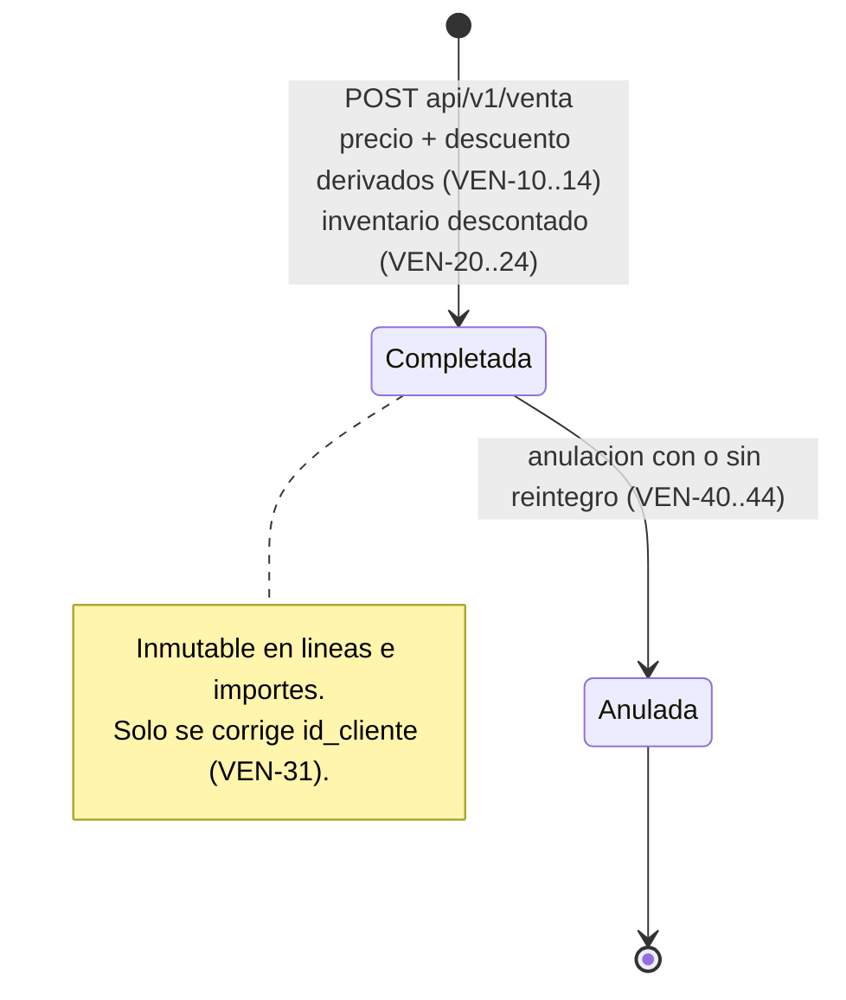
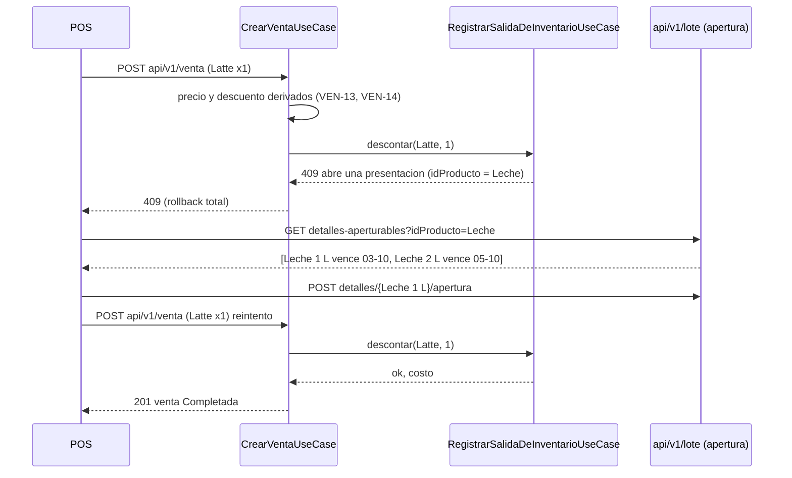

# Especificación del Módulo de Ventas y su Integración con Inventarios

> Documento normativo de **dominio**. Fija las reglas de negocio de la venta en el POS: precio,
> descuentos, disponibilidad, descuento de inventario, anulación y pedidos a domicilio.
>
> Es la contraparte de `inventario.md`. Ventas **no** mueve stock por su cuenta: cada salida,
> reintegro o bloqueo de inventario que provoca una venta se hace con las reglas `INV-xx` de
> `inventario.md`, que se citan por su identificador y no se repiten aquí. Si ambos documentos
> parecen contradecirse, manda `inventario.md` en lo que toca a existencias y movimientos, y
> este documento en lo que toca a importes, estados de la venta y pedidos.
>
> `arquitectura.md` sigue mandando sobre **cómo** se escribe el código. Si una regla de aquí
> obliga a romper una de allí (una ruta fuera de los cinco verbos, un catálogo por nombre), se
> documenta primero en `arquitectura.md`.
>
> Cada regla lleva un identificador (`VEN-xx`). La sección 8 indica qué está implementado.

---

## Glosario

| Término | Significado |
|---|---|
| **Venta** | Encabezado de una transacción del POS (`venta`). Raíz del agregado; contiene sus líneas. |
| **Línea** | `detalle_venta`: un producto, su cantidad, su precio y su descuento. Entidad hija de la venta. |
| **Precio de lista** | `producto.precio` en el momento de la venta. |
| **Descuento vigente** | Fila de `descuentos` viva, activa (`estado = TRUE`) y cuya ventana `[fecha_inicio, fecha_final]` contiene `fecha_venta`. |
| **Anulación** | Único modo de deshacer una venta registrada. Nunca se borra ni se edita (VEN-40). |
| **Reintegro** | Devolución a inventario de lo que la venta descontó, con movimientos compensatorios (VEN-42). |
| **Pedido** | Entrega a domicilio asociada 1:1 a una venta (`pedidos.id_venta UNIQUE`). |
| **MTS / MTO / backflush / FEFO** | Como en `inventario.md`. |

---

## 1. Ciclo de Vida de una Venta



- **VEN-01 — Una venta nace completada.** En el POS de la cafetería la venta se cobra al
  registrarse. `POST api/v1/venta` deja la venta en el estado `Completada` y, en la misma
  transacción, descuenta el inventario de todas sus líneas. No existe venta "pendiente" con
  inventario reservado: si la venta existe, el inventario ya salió.
- **VEN-02 — El estado no lo elige el cliente.** El payload de alta no acepta
  `idEstadoVenta`. El sistema asigna `Completada` al registrar y `Anulada` al anular. Ninguna
  otra transición existe.
- **VEN-03 — Catálogo `estado_venta`**, resuelto por nombre, igual que los roles:

  | Nombre | Significado |
  |---|---|
  | `Completada` | Cobrada, con su inventario descontado |
  | `Anulada` | Sin efecto comercial. Sus movimientos siguen en el libro mayor y, si hubo reintegro, junto a sus compensatorios |

- **VEN-04.** Una venta tiene al menos una línea viva (`Venta.validarRegistrable`). `total` y
  `subtotal` son siempre derivados (`arquitectura.md` 5.13).

---

## 2. Importes: Precio y Descuentos

### 2.1 Qué se puede vender

- **VEN-10.** Solo se vende un producto vivo con `vendible = TRUE` (400 si no).
- **VEN-11 — Se venden productos base, no presentaciones.** Una línea no puede referir a un
  producto con `id_producto_padre` (una *caja de 24 aguas*): se vende el producto base (*agua
  500 ml*), que sale de las existencias abiertas desde cualquiera de sus presentaciones
  (INV-08). Si se quiere vender la caja cerrada entera, es un producto base propio con su
  propio lote.
- **VEN-12.** `cantidad > 0`. Admite decimales para productos vendidos a granel (café en grano
  por kg), en la `unidad_actual` del producto, que es la misma en la que el inventario lo
  descuenta (INV-32).

### 2.2 Precio

- **VEN-13 — El precio unitario lo pone el sistema.** `detalle_venta.precio_unitario` es
  `producto.precio` en el momento del alta, copiado a la línea. El cliente del POS no lo
  envía; si lo envía, se rechaza con 400. Copiarlo (y no referenciarlo) congela el precio
  histórico: un cambio de lista posterior no reescribe ventas pasadas (`Venta.restaurar` ya no
  recalcula el total).

### 2.3 Descuentos

- **VEN-14 — El descuento lo resuelve el sistema desde `descuentos`.** Para cada línea se
  buscan los descuentos vigentes del producto (glosario). El tipo lo da `tipo_descuento`,
  resuelto por nombre:

  | `tipo_descuento.nombre` | `descuentos.descuento` significa | Descuento de la línea |
  |---|---|---|
  | `Porcentaje` | Porcentaje, 0 < d ≤ 100 | `precio × cantidad × d / 100` |
  | `Monto fijo` | Importe por unidad, d > 0 | `min(d, precio) × cantidad` |

  - Si hay varios vigentes, se aplica **uno solo**: el de mayor importe para el cliente. No
    se acumulan.
  - El resultado se redondea a 2 decimales con `HALF_UP` y nunca supera `precio × cantidad`.
  - `descuento_aplicado` queda copiado en la línea, igual que el precio (VEN-13): desactivar
    el descuento mañana no cambia la venta de hoy.
  - El cliente no envía `descuentoAplicado`. Un descuento manual (cortesía, error de cobro)
    no es parte de esta versión; si se necesita, se modela como un `descuentos` vigente
    creado por un `Administrador`.
- **VEN-15 — Fórmulas** (las que ya aplica `DetalleVenta`):

  ```
  subtotal = precio_unitario × cantidad − descuento_aplicado      (≥ 0)
  total    = Σ subtotal de las líneas vivas                      (NUMERIC(12,2), HALF_UP)
  ```

- **VEN-16.** Dos líneas del mismo producto en una venta se aceptan, pero el POS debería
  agruparlas. Cada línea se descuenta de inventario por separado, dentro de la misma
  transacción.

---

## 3. Integración con Inventarios

### 3.1 Disponibilidad antes de vender

- **VEN-20 — El POS consulta, el backend decide.** Para mostrar si un producto se puede
  vender, el POS usa `GET api/v1/producto/{id}/inventario`:
  - MTS: `disponible` es el contenido abierto y vigente (INV-30);
  - MTO: `disponible` son las unidades enteras que alcanzan los insumos abiertos (INV-31);
  - `disponibleTrasAbrir` avisa que hay empaques cerrados que alcanzarían si se abren.

  Es informativo. La única validación que cuenta es la que ocurre dentro de la transacción de
  la venta, con los bloqueos tomados (INV-54): entre la consulta y el cobro otra caja pudo
  vender lo último.

### 3.2 Descuento de inventario al registrar

- **VEN-21 — Una sola transacción** (INV-50, INV-51):
  1. Validar referencias (usuario, cliente) y cada línea (VEN-10..12).
  2. Resolver precio y descuento de cada línea (VEN-13, VEN-14) y armar la venta.
  3. Guardar la venta y sus líneas con estado `Completada`.
  4. Por cada línea, **en orden de `id` de producto** (INV-53), descontar su cantidad con el
     algoritmo de consumo (INV-32):
     - MTS → sale de sus existencias FEFO; movimiento `Venta`;
     - MTO → backflush de su receta vigente; movimientos `Consumo venta`.

     Todos los movimientos citan la venta en su `motivo` (`"Venta '<id>'"`); `movimientos` no
     guarda `id_detalle_venta` (INV-33).
  5. Registrar el costo de cada línea (VEN-23).
  6. Si cualquier paso falla, no queda ni la venta, ni sus líneas, ni un solo movimiento.
- **VEN-22 — Stock insuficiente.** El inventario nunca abre empaques por su cuenta (INV-34):

  | Respuesta del backend | Qué hace el POS |
  |---|---|
  | 409 `"Stock abierto insuficiente de '<producto>' (idProducto '<id>') ... abre una presentacion para continuar"` | Abre el diálogo de apertura con `GET api/v1/lote/detalles-aperturables?idProducto=<id>` (INV-13). El usuario elige la presentación, se abre (INV-14) y el POS **reintenta la misma venta** |
  | 409 `"Stock insuficiente de '<producto>' ..."` | No hay nada que abrir: se quita el producto o se reduce la cantidad |

  El reintento es seguro: la venta fallida no dejó escrituras. Para el MTO el `idProducto` del
  mensaje es el del **insumo** que falta (el grano), no el del café.
- **VEN-23 — Costo de lo vendido.** El algoritmo de consumo devuelve el costo de lo
  descontado (INV-35). Se guarda por línea en `detalle_venta.costo_total` (columna nueva,
  `NUMERIC(12,4)`), de modo que el margen de una venta (`subtotal − costo_total`) se lee sin
  recorrer el libro mayor. Es derivado: nunca lo envía el cliente.
- **VEN-24 — Qué no hace la venta:** no toca `producto.stock` directamente (lo recalcula el
  inventario, INV-20), no crea existencias y no decide qué empaque abrir.



---

## 4. Modificación de una Venta Registrada

- **VEN-30 — Una venta completada es inmutable en lo que movió inventario.** Productos,
  cantidades, precios, descuentos, fecha y usuario no se corrigen: esas cifras ya
  justificaron movimientos inmutables (INV-40) y un costo (VEN-23). Un error se corrige
  **anulando** (VEN-40) y registrando una venta nueva.
- **VEN-31.** `PUT api/v1/venta/{id}` solo admite `idCliente` (asociar el cliente a una venta
  ya cobrada, por ejemplo para su factura). Cualquier otro campo, incluido `detalles`, se
  rechaza con 400. La conciliación de líneas por id que hoy acepta el `PUT` deja de estar
  disponible para ventas completadas.
- **VEN-32.** Una venta `Anulada` no admite ningún cambio (409).
- **VEN-33.** `DELETE api/v1/venta/{id}` no borra ni da de baja una venta: responde 409 e
  indica usar la anulación. La baja lógica escondería una venta cuyo inventario ya salió; la
  anulación, en cambio, deja la traza completa.

---

## 5. Anulación y Reintegro

- **VEN-40 — Anular una venta:**

  ```
  POST api/v1/venta/{id}/anulacion   { "idUsuario": "...", "motivo": "...", "reintegrar": true|false }
  ```

  - Requiere `@RequiereRol("Administrador")`: una anulación deshace un cobro.
  - `motivo` es obligatorio.
  - Solo se anula una venta `Completada` (409 si ya está `Anulada`).
  - La venta pasa a `Anulada`. Sus líneas, precios, costos y movimientos se conservan.
  - Todo en una transacción (INV-50).
- **VEN-41 — Sin reintegro (`reintegrar = false`), el caso por defecto.** El producto se
  entregó o se preparó: un café servido no vuelve a la bolsa. La venta queda sin efecto
  comercial y **el inventario no cambia**. Lo consumido sigue explicado por sus movimientos
  `Venta` / `Consumo venta`, que ahora apuntan a una venta anulada; los reportes lo tratan
  como pérdida (sección 7.3).
- **VEN-42 — Con reintegro (`reintegrar = true`).** Nada se entregó ni se preparó (error de
  digitación, pedido cancelado antes de cocina). Por **cada** movimiento de salida de la venta
  se registra un movimiento compensatorio `Devolucion venta` (entrada) por la misma cantidad:
  - si su existencia sigue viva y no agotada, sobre esa misma existencia, sin superar su
    `contenido_inicial`;
  - si su existencia está `Agotada`, no se revive (INV-05): se crea una existencia nueva
    `Abierta` sobre el mismo `detalle_lote`, con esa cantidad, la misma unidad y la misma
    `fecha_vencimiento`, y el compensatorio se registra sobre ella. Es el tercer origen
    admitido de una existencia, junto a la apertura y la producción (INV-12);
  - si la existencia está vencida, el reintegro de esa parte se registra y se da de baja de
    inmediato como `Vencimiento` (INV-42), para que el libro mayor cuadre sin devolver a la
    venta algo vencido.

  El motivo de cada compensatorio cita la venta: `"Anulacion de la venta '<id>'"`. Después se
  recalcula `producto.stock` de cada producto tocado (INV-20). Los bloqueos siguen INV-52 e
  INV-53: primero las existencias y al final los productos.
- **VEN-43 — El reintegro es todo o nada.** Si una parte no se puede reintegrar, la anulación
  entera falla (409) y la venta sigue `Completada`. El usuario puede anular sin reintegro.
- **VEN-44.** No hay anulación parcial (una sola línea). Se anula la venta completa y se
  registra de nuevo lo que sí se vendió.

---

## 6. Pedidos a Domicilio

- **VEN-50.** Un pedido es la entrega de **una** venta ya completada: primero se registra la
  venta (VEN-21) y después su pedido (`POST api/v1/pedido`, con `idVenta`). El inventario
  sale al vender, no al despachar. Un pedido no puede apuntar a una venta `Anulada` (409).
- **VEN-51 — Catálogo `estado_pedido`**, resuelto por nombre:

  | Nombre | Siguiente permitido |
  |---|---|
  | `Recibido` | `En preparacion`, `Cancelado` |
  | `En preparacion` | `En camino`, `Cancelado` |
  | `En camino` | `Entregado`, `Cancelado` |
  | `Entregado` | — |
  | `Cancelado` | — |

  Cualquier otra transición se rechaza con 409.
- **VEN-52 — Cancelar un pedido anula su venta** en la misma transacción:
  - en `Recibido` (nada se preparó), con reintegro (VEN-42);
  - en `En preparacion` o `En camino`, sin reintegro (VEN-41): lo preparado ya se consumió.
- **VEN-53.** Un pedido `Entregado` no se cancela. Si el cliente devuelve el producto, es una
  anulación sin reintegro, salvo que un `Administrador` decida reintegrar lo que vuelve
  intacto.

---

## 7. Reglas de Integridad, Concurrencia y Consultas

### 7.1 Integridad

| Id | Invariante | Dónde |
|---|---|---|
| VEN-60 | `precio_unitario ≥ 0`, `cantidad > 0`, `0 ≤ descuento_aplicado ≤ precio × cantidad`, `subtotal ≥ 0` | `DetalleVenta` + CHECK propuesto |
| VEN-61 | `total = Σ subtotal` de las líneas vivas | `Venta.recalcularTotal` |
| VEN-62 | Una venta `Completada` tiene todos sus movimientos de salida; una `Anulada` con reintegro tiene además un compensatorio por cada uno | caso de uso de alta y de anulación |
| VEN-63 | Un pedido referencia una venta no anulada, y una venta tiene a lo sumo un pedido | `pedidos.id_venta UNIQUE` + caso de uso |

CHECK propuestos para `databasev4.sql`:

```sql
ALTER TABLE detalle_venta ADD CONSTRAINT chk_detalle_venta_importes CHECK (
    precio_unitario >= 0 AND cantidad > 0 AND descuento_aplicado >= 0 AND subtotal >= 0);
ALTER TABLE venta ADD CONSTRAINT chk_venta_total CHECK (total >= 0);
```

### 7.2 Concurrencia e idempotencia

- **VEN-64.** Dos cajas vendiendo lo último: la primera toma los bloqueos de las existencias
  (INV-52), la segunda espera, revalida (INV-54) y recibe 409. Nunca se vende más de lo que
  hay; lo prueba `FlujoInventarioIntegracionTest.dosVentasSimultaneasNoConsumenMasDeLoQueHay`.
- **VEN-65.** Un interbloqueo entre dos ventas MTO cuyas recetas comparten insumos en orden
  distinto (límite de INV-53) aborta una de ellas. El backend debe responder 409
  `"La venta no se pudo completar por concurrencia; reintenta"`, no 500: la venta abortada no
  dejó escrituras y el reintento es seguro.
- **VEN-66 — Idempotencia del alta.** Si el POS no recibe respuesta (timeout) y reintenta,
  no debe cobrar dos veces. El alta acepta una `claveIdempotencia` opcional generada por el
  POS: si ya existe una venta con esa clave, se devuelve esa venta (200) en lugar de crear
  otra. Requiere una columna `venta.clave_idempotencia` con índice único parcial
  `WHERE clave_idempotencia IS NOT NULL`.

### 7.3 Consultas

| Consulta | Cálculo |
|---|---|
| Ventas de un período | `venta` `Completada` por `fecha_venta` |
| Ingreso | Σ `total` de las ventas `Completada` |
| Costo de lo vendido | Σ `detalle_venta.costo_total` de las ventas `Completada` (VEN-23) |
| Margen | Ingreso − costo de lo vendido |
| Pérdida por anulación sin reintegro | Σ `costo_total` de las ventas `Anulada` sin compensatorios |
| Insumos consumidos por una venta | `movimientos` cuyo `motivo` cita la venta |

### 7.4 Errores

| Código | Situación |
|---|---|
| 400 | Payload inválido; precio, descuento o estado enviados por el cliente; producto no vendible o presentación; `PUT` con campos no admitidos |
| 403 | Anulación sin rol `Administrador` |
| 404 | Venta, producto, usuario o cliente inexistente; fila de catálogo requerida no sembrada |
| 409 | Stock insuficiente o por abrir (VEN-22); venta ya anulada; reintegro imposible (VEN-43); `DELETE` de una venta (VEN-33); transición de pedido inválida; concurrencia (VEN-65) |

---

## 8. Estado de Implementación

Estado al 2026-09-27 respecto del código en `feature-inventarios`.

| Regla | Estado | Nota |
|---|---|---|
| VEN-04 Al menos una línea; total y subtotal derivados | Implementado | `Venta`, `DetalleVenta` |
| VEN-21 Alta en una transacción con descuento de inventario | Implementado | `CrearVentaUseCase` + `RegistrarSalidaDeInventarioUseCase`, líneas en orden de `id` de producto |
| VEN-22 409 que remite a abrir una presentación | Implementado | Mensaje e `idProducto` de INV-34 |
| VEN-64 Sin sobreventa concurrente | Implementado | Test de concurrencia |
| VEN-01..03 Estado asignado por el sistema | **Pendiente** | Hoy el alta recibe `idEstadoVenta` del cliente; falta sembrar `Completada` y `Anulada` |
| VEN-10..12 Vendible y solo productos base | **Pendiente** | |
| VEN-13 Precio desde `producto.precio` | **Pendiente** | Hoy el POS envía `precioUnitario` |
| VEN-14 Descuento desde `descuentos` | **Pendiente** | Hoy el POS envía `descuentoAplicado`; falta sembrar `Porcentaje` y `Monto fijo` |
| VEN-23 `detalle_venta.costo_total` | **Pendiente** | Columna nueva; el costo ya lo devuelve el consumo |
| VEN-30..33 Venta inmutable; `PUT` solo `idCliente`; `DELETE` → 409 | **Pendiente** | Hoy el `PUT` concilia líneas y el `DELETE` da de baja **sin tocar inventario**: ambos pueden desalinear ventas e inventario |
| VEN-40..44 Anulación y reintegro | **Pendiente** | Nuevo endpoint y tipo de movimiento `Devolucion venta` (entrada) |
| VEN-50..53 Pedidos | **Pendiente** | Hoy `Pedido` es CRUD sin transiciones ni vínculo con la anulación |
| VEN-60 CHECK de importes | **Pendiente** | El dominio ya valida |
| VEN-65 Interbloqueo como 409 | **Pendiente** | Hoy llega como 500 |
| VEN-66 Idempotencia del alta | **Pendiente** | Columna e índice nuevos |

**Riesgo actual a cerrar primero:** VEN-30..33. Mientras el `PUT` y el `DELETE` de venta sigan
como CRUD, una corrección o una baja cambian la venta sin mover el inventario que ella ya
descontó.
